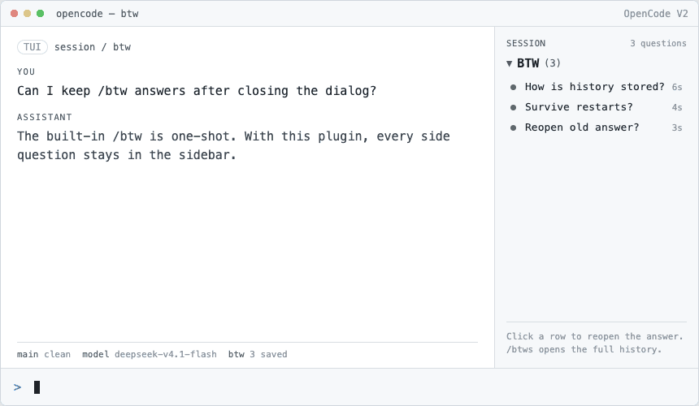

# @mensa/btw

[English](#english) · [中文](#中文)

## English

A drop-in enhancement for OpenCode's built-in `/btw`: the question flow, prompt, and answer dialog stay the same. It adds only two things: a persistent sidebar history and `/btws`.



### Install

```sh
opencode plugin add @mensa/btw
```

Disable the built-in `/btw` and enable the plugin in `~/.config/opencode/cli.json`:

```jsonc
{
  "plugins": ["-opencode.btw", "@mensa/btw"]
}
```

Restart the TUI. Requires OpenCode V2.

### What you get

- **Sidebar history**: every `/btw` question in the current session, with a status dot and duration. Click a row to reopen that answer.
- **Collapsible list**: click `BTW (n)` when there are more than two questions.
- **`/btws`**: type to filter this session's questions and press Enter to open one.
- **Persistence**: history survives TUI restarts and multiple windows.

## 中文

内置 `/btw` 的无缝增强：**提问方式、生成提示、答案弹窗的展示与操作，都和内置版完全一致**；在此之上只新增两样东西——**历史记录** 和 **侧边栏展示**。

### 安装

```sh
opencode plugin add @mensa/btw
```

你需要手动在 `~/.config/opencode/cli.json` 的 "@mensa/btw" 前新增 `"-opencode.btw"`，以禁用内置的同名命令：

```jsonc
// ~/.config/opencode/cli.json
{
  "plugins": ["-opencode.btw", "@mensa/btw"]
}
```

重启 TUI 生效，与内置 /btw 完全一致，原有使用习惯无需改变，仅新增两个功能：

### 新增一：侧边栏历史列表

- 会话右侧的 **BTW** 区，按时间列出本会话问过的每个 `/btw` 问题
- 每行 = 状态圆点 + 问题 + 耗时（`6s`；生成中 `…`；失败 `failed`）
  - 绿点 = 已回答　转圈色 = 生成中　红点 = 失败
- **点击任意一行**，重新打开那次的答案弹窗（展示与按键和内置一致）
- 超过 2 条时，点击标题 `BTW (n)` 可折叠/展开
- 内置版关掉弹窗记录就没了；这里每条都留在列表里，**重启 TUI、多开窗口都不丢**

### 新增二：`/btws` 历史选择

输入 `/btws` 回车，弹出本会话全部问答的选择框；直接打字过滤问题，回车打开对应答案。

### 卸载

```sh
opencode plugin remove @mensa/btw
```

然后从 `cli.json` 删掉 `"-opencode.btw"` 一行，即恢复内置 `/btw`。
